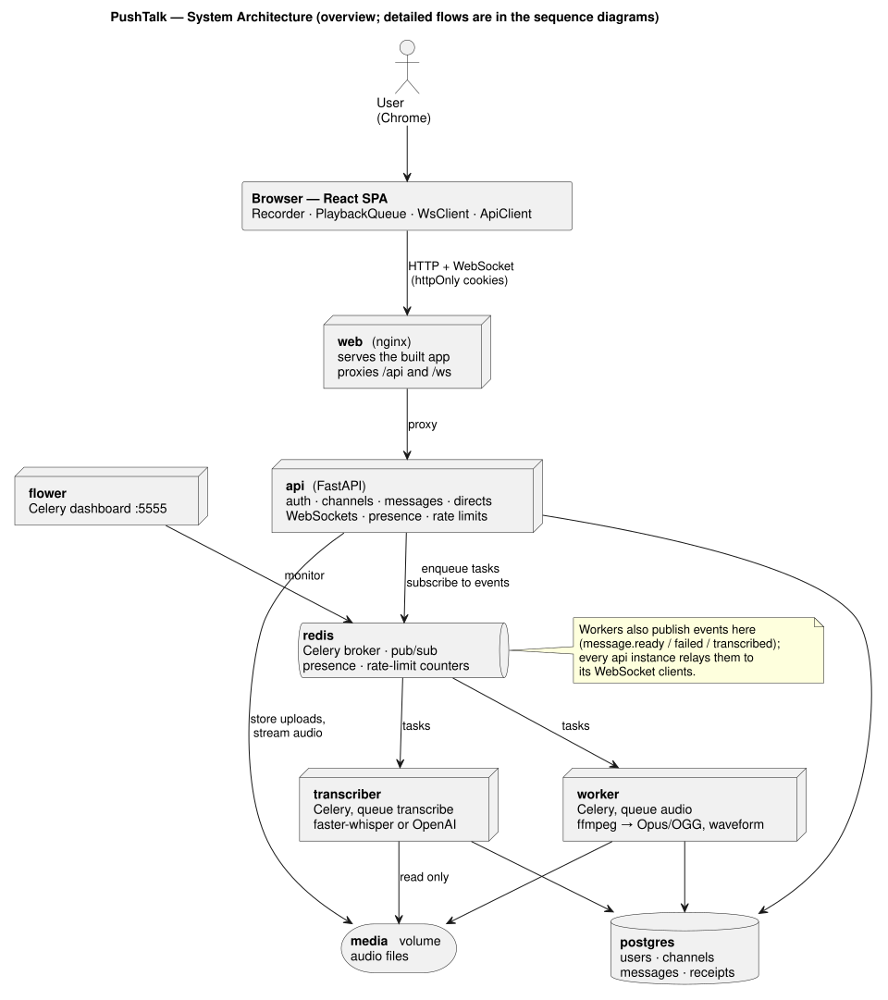

<p align="center">
  <picture>
    <source media="(prefers-color-scheme: dark)" srcset="apps/web/brand/logo-dark.svg" />
    
  </picture>
</p>

<p align="center"><strong>Walkie-talkie voice channels in the browser.</strong><br />Hold to talk, release to send. Everyone in the channel hears it automatically, in order.</p>

---

## Quick start

Requires Docker with Compose v2. From the repository root:

```bash
docker compose up --build
```

Then open <http://localhost:8080>. No `.env` file is needed: every setting has a development default (see [`.env.example`](.env.example)). The first build takes a few minutes, mostly to download the speech-recognition model into the transcriber image; later starts take seconds.

To try it, sign up in two browser windows (for example, a normal and a private window), create a channel in one, join it in the other, and hold the microphone button (or the Space bar) to talk.

With `make` installed, `make up` does the same in the background, and `make help` lists every command.

| Address | What |
| --- | --- |
| <http://localhost:8080> | The app (nginx: web app, `/api`, `/ws`) |
| <http://localhost:8080/api/docs> | API reference (OpenAPI) |
| <http://localhost:5555> | Flower, the Celery dashboard: user `admin`, password `pushtalk-dev` (localhost only) |

`make down` stops everything and keeps the data; `make reset` also deletes it.

## Features

- **Accounts:** sign up, log in, stay logged in across tabs; logging out ends the session in every tab at once.
- **Channels:** create, browse and join channels; see who is online, live.
- **Push to talk:** hold the button or Space to record (0.5–60 s), release to send. Messages appear at once and show *sending*, then *sent*.
- **Autoplay in order:** incoming messages play automatically, one at a time, in channel order; the user's own never play back. While someone is talking, incoming messages wait and play after release. Browsers block audio until the first tap; a banner says how many messages are waiting.
- **Catch-up:** after a dropped connection the app reconnects with backoff and plays what was missed; history pages back on demand.
- **Status:** *sent → delivered n/m → played n/m* on each message, live; a click shows who received and played it, and when.
- **One playing tab:** with several tabs or devices open on the same channel, only one plays; the others offer "Play here".
- **Server-side processing:** every recording is validated (real type, size and duration), converted to Opus/OGG and measured by a worker before anyone receives it; failures are shown to the sender with a retry.
- **Playback speed:** 1×, 1.5× or 2×, remembered across reloads.
- **Transcription:** the text of each message appears under it shortly after the audio (local faster-whisper by default, OpenAI optionally).
- **Direct messages:** find someone by username and talk one to one; the conversation appears for the other person at once.
- **Rate limits:** per user and per IP on log-in, sign-up, uploads, channel and conversation creation, and WebSocket events.

## Architecture



- **web** (nginx) serves the built React app and proxies `/api` and `/ws` to the API, so the browser sees one origin and the httpOnly auth cookies reach every endpoint.
- **api** (FastAPI) handles REST and WebSockets. An upload is validated and stored, a job is queued, and the API answers `202` at once.
- **worker** (Celery, queue `audio`) converts the recording with ffmpeg, measures it, numbers it within the channel (`seq`) in the same transaction that marks it ready, and publishes `message.ready` on Redis. Every API process relays Redis events to its WebSocket clients.
- **transcriber** (Celery, queue `transcribe`) adds the text afterwards, so transcription never delays delivery.
- **postgres** holds users, channels, messages and receipts; **redis** is the job broker, the event bus, presence and the rate-limit store; audio files live on the **media** volume and are served only to channel members.

The detailed flows (voice pipeline, reconnect and catch-up, playback and receipts, transcription, direct messages), the data model and the class diagrams are in [`specs/`](specs/README.md). The design choices and their trade-offs are in [`DECISIONS.md`](DECISIONS.md).

## Stack

| Layer | Technology |
| --- | --- |
| Backend | Python 3.12, FastAPI, SQLAlchemy 2 (async), Alembic, Pydantic |
| Jobs and realtime | Celery + Redis (broker, pub/sub), Flower; ffmpeg; faster-whisper |
| Storage | PostgreSQL 16; audio files on a Docker volume |
| Frontend | React 19 + TypeScript, Vite, Tailwind CSS, shadcn/ui, Zustand, TanStack Query |
| Edge and runtime | nginx, Docker Compose |

## Configuration

Every setting is an environment variable with a development default, listed and explained in [`.env.example`](.env.example). Copy it to `.env` to change any of them; `.env` is ignored by Git. The ones most likely to matter:

| Variable | Default | Purpose |
| --- | --- | --- |
| `WEB_PORT` | `8080` | Port of the app on the host |
| `JWT_SECRET` | development value | Signing key for access tokens; set a random value of 32+ bytes outside local development |
| `TRANSCRIBE_PROVIDER` | `local` | `local` (faster-whisper), `openai` (needs `OPENAI_API_KEY`) or `off` |
| `WHISPER_MODEL` | `base` | Speech model size for `local` |
| `RATE_LIMIT_*` | see the file | Limits as `<requests>/<seconds>` |
| `FLOWER_BASIC_AUTH` | `admin:pushtalk-dev` | Flower login |

## Development

```bash
make dev        # everything in Docker, API on :8001 with hot reload, PostgreSQL :5433, Redis :6380
cd apps/web && pnpm install && pnpm dev    # web app with hot reload on http://localhost:5173
```

The setup of each tool (Node, pnpm, Python, uv, Docker) is in [`steps/environment-setup.md`](steps/environment-setup.md); each app's own commands and layout are in [`apps/api/README.md`](apps/api/README.md) and [`apps/web/README.md`](apps/web/README.md).

### Tests

```bash
make test       # API (pytest) and web (Vitest); the API tests need `make dev` or `make services`
make lint       # ruff, mypy (strict), ESLint, TypeScript
```

- **API (140 tests):** auth (sign-up, log-in, refresh rotation and reuse detection, log-out, CSRF), upload validation (oversized, renamed text file, too short and too long, corrupt audio, non-member, retried upload, queue down), the worker job with real ffmpeg (ready, ordering, failure, idempotency, retries), catch-up, receipts (including two tabs reporting at once), playback ownership (one playing tab, joining and reconnecting tabs), presence, rate limits, transcription (job, providers, decoding), and direct messages (privacy, races, search). They run against a real PostgreSQL test database, each test inside a rolled-back transaction.
- **Web (42 tests):** the playback queue in isolation (order, one at a time, duplicates, own messages, locked, recording, errors, tabs, messages played elsewhere, speed), the WebSocket client (backoff, online and offline, 4401 and 4403), backoff bounds and the message store.

## Known limitations

- **Browsers:** built and tested in Chrome, as the brief requires. Firefox records Opus in Ogg, which the server accepts; it was not tested end to end. Safari records AAC, which the server accepts and converts, but playback of the Opus result depends on the Safari version; it was not tested.
- **Ordering** follows when processing finishes, not when the button was released: two people releasing within about a second of each other may be heard in finishing order ([`DECISIONS.md` 1.5](DECISIONS.md#15-how-is-message-ordering-guaranteed-including-after-a-reconnect)).
- **After a reload**, the first tap starts audio; browsers allow nothing less.
- **Transcription** runs on the CPU one message at a time, so the text appears a few seconds after the audio and a burst of long messages queues up.
- **Online dots** next to direct conversations refresh every 30 s; presence inside a room is live.
- **Single host:** audio is on a local volume, and the compose setup serves plain HTTP (secure cookies work on `localhost` only).

The full list, and what would come next with more time, is in [`DECISIONS.md`](DECISIONS.md#4-known-limitations).

## Repository layout

```text
apps/api/       FastAPI app, Celery workers, migrations and tests (Python, uv)
apps/web/       React app, nginx config and brand assets (TypeScript, pnpm)
specs/          Phased plans, diagrams (PlantUML sources and SVGs)
steps/          Environment setup guide
DECISIONS.md    Design decisions and trade-offs
AI_USAGE.md     Which AI tools were used, and for what
```

## Documentation

- [Decisions](DECISIONS.md): the design questions, options considered and trade-offs
- [Specs and diagrams](specs/README.md): plans, flows and data model per area
- [Environment setup](steps/environment-setup.md): tools, versions and first-run commands
- [AI usage](AI_USAGE.md)
