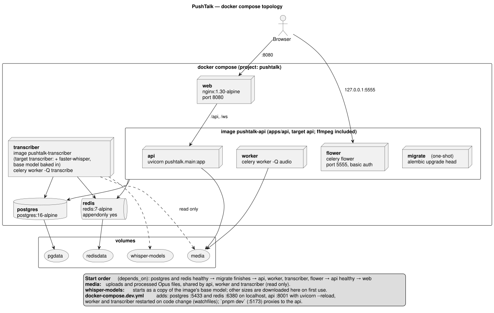

# App architecture & infrastructure: plan

Monorepo reasoning: [`monorepo-decision.md`](monorepo-decision.md)

## Goal

A polyglot monorepo (`apps/api` Python/FastAPI, `apps/web` React/TS) that runs end to end with `docker compose up` on a fresh clone. It has clear backend layers, env-only config, structured logs and one consistent error shape.

## Diagrams

### System architecture


### docker compose topology



## Stack decisions (summary; reasoning and trade-offs in `DECISIONS.md`)

| Concern | Choice | Why |
| --- | --- | --- |
| Repository | Plain polyglot monorepo: `apps/api` + `apps/web`, root `Makefile` and `docker-compose.yml` | Two apps in two languages; a monorepo framework adds config with no payoff |
| Package managers | uv (Python), pnpm via Corepack (TypeScript) | Fast, lockfile-based, versions pinned in the repository |
| Backend | FastAPI, Python 3.12, SQLAlchemy 2 (async) + asyncpg | Required stack; async fits WebSockets |
| Backend layout | `src/pushtalk/`, one folder per feature (`auth`, `channels`, `messages`, `dms`), each with router → service → repository → models → schemas | Layers stay explicit; one feature lives in one folder |
| Migrations | Alembic (async template) | Standard with SQLAlchemy |
| Auth | JWT access token (15 min) + opaque rotating refresh token (7 days), both in httpOnly `SameSite=Strict` cookies; Origin check on unsafe requests | No token readable by scripts; WebSocket and `<audio src>` authenticate with the cookie |
| Job queue | **Celery** (Redis broker), queues `audio` and `transcribe`, **Flower** dashboard | Industry standard, rich retries and routing; tasks call the shared async code through `asyncio.run()` |
| Pub/sub | Redis pub/sub, topics `ch:{channel_id}` and `user:{user_id}` | Fan-out across multiple API replicas |
| Media | **Local Docker volume** behind `FileStorage` (MinIO planned; its images are no longer published) | An S3 implementation of the same interface is a contained change |
| Frontend | React + TS + Vite, Tailwind + shadcn/ui, Zustand (client state), TanStack Query (REST cache) | Small, explicit state boundaries; accessible UI primitives |
| Frontend layout | `src/features/{auth,channels,voice,dms}` + `src/shared/{ui,lib}` | Feature boundaries match the backend |
| Edge | nginx in the `web` image | Serves the SPA and proxies `/api` and `/ws`: one origin, no CORS, cookies work everywhere |
| Logs | structlog → JSON to stdout, `request_id` middleware | "basic structured logs" |
| Rate limiting | Redis sliding window (`ZADD` + `ZREMRANGEBYSCORE` + `ZCARD` in one `MULTI`) | Per-user limits, shared by auth and chat |
| Transcription | Separate `transcriber` service on Celery queue `transcribe`. Provider set by `TRANSCRIBE_PROVIDER`: `local` (default, faster-whisper, model from `WHISPER_MODEL`, `base` baked into the image) or `openai` (optional, needs `OPENAI_API_KEY`) | Works offline with no keys on a fresh clone; a cloud engine is a config change; slow inference never blocks delivery |

## Cross-cutting conventions

**Error envelope** (every non-2xx, REST and WS `error` events):

```json
{ "error": { "code": "invalid_audio", "message": "Recording must be 0.5–60 s", "details": [] }, "request_id": "…" }
```

- `AppError(code, message, status)` base class, plus handlers for `AppError`, `RequestValidationError` (→ 422 `validation_error` with field details) and unhandled `Exception` (→ 500 `internal_error`, logged with stack trace, no internals leaked).

**Config**: `src/pushtalk/core/config.py` uses `pydantic-settings`, and every value comes from env. Each key has a safe development default, so `docker compose up` works without a `.env` file; `.env.example` documents them all.

| Group | Keys |
| --- | --- |
| Infrastructure | `DATABASE_URL`, `REDIS_URL`, `CELERY_BROKER_URL`, `MEDIA_DIR` |
| Auth | `JWT_SECRET`, `ACCESS_TOKEN_TTL_MIN`, `REFRESH_TOKEN_TTL_DAYS`, `REFRESH_REUSE_GRACE_S`, `COOKIE_SECURE`, `ALLOWED_ORIGINS` |
| Audio | `MAX_UPLOAD_BYTES`, `MIN_DURATION_MS`, `MAX_DURATION_MS` |
| Rate limits | `RATE_LIMIT_*` (one per rule) |
| Transcription | `TRANSCRIBE_PROVIDER`, `WHISPER_MODEL`, `TRANSCRIBE_LANGUAGE`, `OPENAI_API_KEY`, `OPENAI_TRANSCRIBE_MODEL` |
| Other | `PRESENCE_TTL_S`, `FLOWER_BASIC_AUTH`, `LOG_LEVEL` |

Startup fails fast with a clear message when a setting is invalid, for example `TRANSCRIBE_PROVIDER=openai` without `OPENAI_API_KEY`.

**Layering rule**: inside a feature, router → service → repository → models. Routers hold no SQL. Services hold no FastAPI types (`Request`, `HTTPException`), so they are testable and reusable from Celery tasks. Across features, a service may call another feature's service, never its repository.

**Celery and async code**: tasks are plain functions that run the shared async services with `asyncio.run()`. Each task creates its own database engine with `NullPool`, because async connections cannot be shared between event loops.

## Phases

### Phase 0: Skeleton (first, it unblocks everything)

Generators create the standard files; the structure that is specific to this project is written by hand. Each service and library arrives in the commit that first uses it, so nothing is installed before it is needed; task 0.9 is the complete stack.

| # | Task | Done when |
| --- | --- | --- |
| 0.1 | `.env.example`, root `Makefile` (`up`, `dev`, `down`, `reset`, `logs`, `test`, `lint`, `types`, `diagrams`), README stub | `make help` lists targets |
| 0.2 | `apps/api`: `uv init --package --name pushtalk`, `uv add` runtime and dev dependencies, FastAPI app factory, `/api/health` (gains one check per dependency as it is added: database and Redis) | `uv run uvicorn pushtalk.main:app` serves health |
| 0.3 | Settings, structlog JSON logging, request-id middleware, error envelope + handlers, `OriginCheckMiddleware` | bad JSON → envelope 422; foreign Origin → 403 |
| 0.3b | `docker-compose.yml` with postgres + redis (health checks, volumes, Redis append-only file); `docker-compose.dev.yml` publishes them on `127.0.0.1:5433` and `127.0.0.1:6380` | both services `healthy`, reachable from the host |
| 0.3c | ruff + **mypy --strict** on `src/`, `tsc --noEmit` strict + eslint on web; `make lint` runs all of them | clean from the first commit |
| 0.4 | SQLAlchemy async engine/session dependency, `alembic init -t async migrations`, empty baseline migration | `alembic upgrade head` OK |
| 0.5 | Moved to Phase 3: the Celery app arrives with its first task, `process_message` (no no-op worker) | — |
| 0.6 | `Dockerfile` for api (python:3.12-slim + uv, non-root, no dev tools); one image for `api` and the `migrate` job. ffmpeg is added in Phase 3, the `transcriber` target in Phase 5 | image builds |
| 0.7 | `apps/web`: `pnpm create vite --template react-ts`, Tailwind + `shadcn init`, Zustand, TanStack Query, vitest, `ApiClient`, router shell, feature folders | `pnpm dev` shows page |
| 0.8 | web `Dockerfile` (node build → nginx) + `nginx.conf` with WS upgrade | `/api/health` works via :8080 |
| 0.9 | `docker-compose.yml`: postgres, redis, migrate, api, web, with healthchecks and start order. worker + flower and the `media` volume join in Phase 3, transcriber in Phase 5 | **fresh clone → `docker compose up` → app on :8080** |
| 0.10 | `docker-compose.dev.yml`: PostgreSQL/Redis on `127.0.0.1:5433`/`6380`, API with `uvicorn --reload` on `127.0.0.1:8001`; `pnpm dev` (:5173) proxies `/api` to it. Celery reload (`watchfiles`) joins in Phase 3; `make dev` | edit a file → reload |

### Phase 1–5

Feature work lives in [`../auth/plan.md`](../auth/plan.md) and [`../chat/plan.md`](../chat/plan.md). Arch-level tasks inside those phases:

- P1: `get_current_user` (cookie) becomes the standard auth guard; refresh rotation and logout publish `session.revoked`; the shared `RateLimiter` arrives with its first user, the login and signup limits.
- P2: `EventBus` (Redis pub/sub) + `ConnectionManager` + `PresenceService`.
- P3: `media` volume; `FileStorage` + `audio` (ffprobe/ffmpeg) infra modules; Celery app (Redis broker, queues `audio` + `transcribe`, `acks_late`, `reject_on_worker_lost`, prefetch 1) with `process_message` and retries; `worker` + `flower` compose services; ffmpeg in the API image.
- P4: nginx `proxy_read_timeout 3600s` for WS; app-level ping every 25 s.
- P5: `transcriber` Dockerfile target with the `base` model downloaded at build time and a `whisper-models` volume for other sizes; provider factory; `/ws/me` user socket; rate-limit rules in env.

### Phase 6: Docs, demo & hand-off

| # | Task |
| --- | --- |
| 6.1 | `README.md`: prerequisites (link to `steps/environment-setup.md`), `docker compose up`, URLs, test commands, architecture diagram (embed `system-architecture.svg`), known limitations and browser issues (see `../chat/plan.md` §Known issues) |
| 6.2 | `DECISIONS.md`: kept up to date as implementation confirms or changes decisions; final pass on trade-offs and "what would be done with twice the time" (a required section of the brief) |
| 6.3 | `AI_USAGE.md`: AI tools used and what for |
| 6.4 | Fresh-clone smoke test: `git clone … && docker compose up` in an empty folder |
| 6.5 | **Demo video (3–5 min)**: login in 2 browsers → create channel → hold-to-talk → autoplay + receipts → transcript appears → 1.5× speed → kill api container → reconnect + catch-up → DM → rate-limit 429 → Flower shows the tasks. Record with OBS or the browser's screen recorder, and link it in the README |

## Testing infrastructure

- **api**: pytest + pytest-asyncio. A separate test database (`pushtalk_test`) is migrated once per session, and each test runs in a transaction that is rolled back. Redis uses `fakeredis`; `FileStorage` writes to a temporary folder; ffmpeg runs for real on generated recordings. Celery tasks are called directly as functions (no broker needed).
- **web**: vitest with jsdom; `PlaybackQueue` tested with `FakeAudioPlayer` (no DOM audio).
- `make test` runs both.

## Risks

| Risk | Mitigation |
| --- | --- |
| Compose race (api starts before migrations) | `migrate` one-shot + `service_completed_successfully` |
| WS dropped by nginx after 60 s | `proxy_read_timeout` + client ping |
| ffmpeg missing in image | installed in the api Dockerfile; health endpoint checks `ffmpeg -version` |
| Celery task lost when a worker dies mid-task | `acks_late` + `task_reject_on_worker_lost`; tasks are idempotent (status guards) so a redelivery is safe |
| Redis restart loses queued tasks (messages stuck in `processing`) | `appendonly yes` with a `redisdata` volume; message state itself lives in Postgres |
| Async database code inside Celery's sync tasks | `asyncio.run()` per task with a `NullPool` engine; covered by worker tests |
| Secure cookies on plain HTTP | Chrome and Firefox accept `Secure` cookies on `http://localhost`; `COOKIE_SECURE=false` covers other hosts during development |
| Full scope (every stretch goal) is large | Nothing is cut. Phases are ordered so the core (0–4) is solid before 5, and commits stay small so progress is always shippable |
| Whisper image is large and slow to build | separate `transcriber` target so the api/worker images stay small; model cached in a build layer |

## Not part of the brief

These aren't requested, so they aren't built and nothing required is dropped: CI pipeline, HTTPS/TLS termination, a horizontal-scaling demo, a metrics/tracing stack, Kubernetes. The design already scales horizontally through Redis pub/sub fan-out, a topic for the live session.
