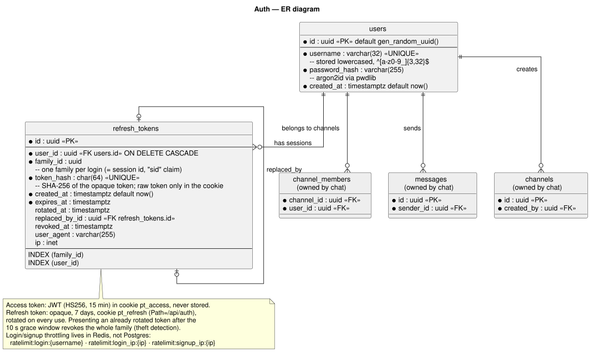
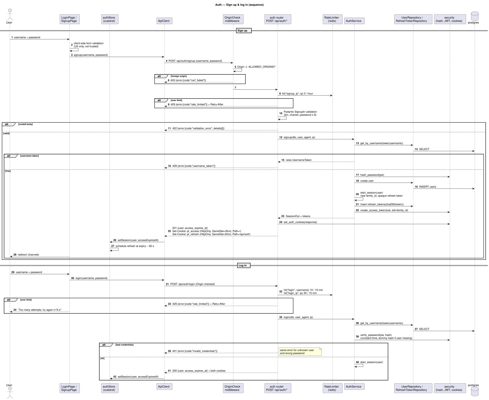
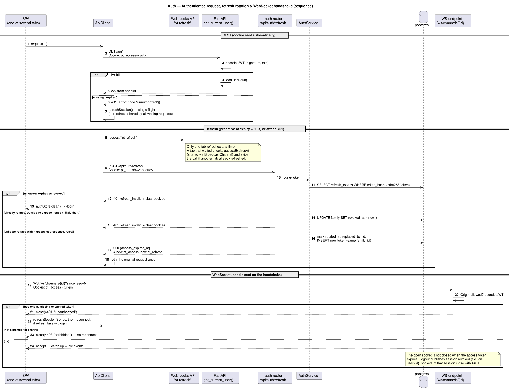
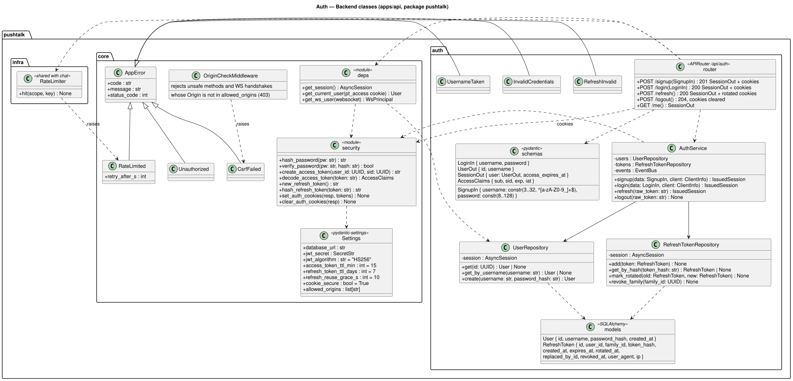
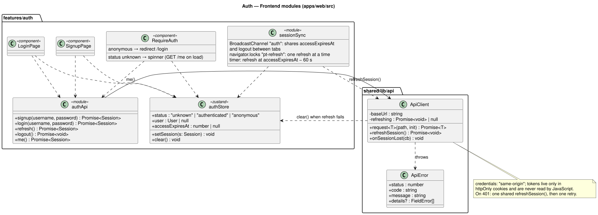

# Auth: plan

User story 1: *sign up and log in with a username and password (JWT or session).*

Diagrams are shown in [Diagrams](#diagrams) below. Sources: `er-diagrams.puml`, `uml-diagrams.puml`, `class-diagrams.puml` (each `@startuml <name>` block renders to `<name>.svg`).

## Decisions

| Question | Choice | Reason / trade-off |
| --- | --- | --- |
| JWT or session? | **JWT access token + opaque refresh token** | Short-lived stateless access checks on every request; the refresh token gives real logout and revocation |
| Access token | JWT (HS256), 15 min, claims `sub`, `sid` (session id), `exp`, `iat`; cookie `pt_access` (`HttpOnly`, `Secure`, `SameSite=Strict`, `Path=/`) | Never readable by scripts, so an XSS bug cannot steal it. Sent automatically on REST, the WebSocket handshake and `<audio src>` |
| Refresh token | Random 256-bit opaque token, 7 days; cookie `pt_refresh` (`HttpOnly`, `Secure`, `SameSite=Strict`, `Path=/api/auth`); stored only as a SHA-256 hash in `refresh_tokens` | `Path=/api/auth` keeps it off every other request. A database leak does not reveal usable tokens |
| Rotation | Every refresh issues a new refresh token in the same family and marks the old one rotated | A stolen token is useful once at most |
| Reuse detection | Presenting an already rotated token **after** a 10 s grace window revokes the whole family (all tokens of that login) | Detects theft. The grace window covers a lost response followed by a retry |
| Several tabs | Web Locks API (`navigator.locks`, lock `pt-refresh`): one tab refreshes at a time; tabs share `accessExpiresAt` and logout through `BroadcastChannel` | Prevents two tabs from rotating the same token and triggering reuse detection |
| When to refresh | Proactively at expiry − 60 s, and reactively after a 401 (single flight: one refresh shared by all waiting requests, then one retry) | Users never see an expiry; no refresh storms |
| CSRF | `SameSite=Strict` cookies **and** an Origin check: unsafe methods and WebSocket handshakes from an origin outside `ALLOWED_ORIGINS` get 403 `csrf_failed` | Cookies are sent automatically, so requests from other sites must be refused |
| Logout | `POST /api/auth/logout` revokes the family, clears both cookies and publishes `session.revoked {sid}`; open sockets of that session close with `4401` | Real server-side logout |
| WS auth | Cookie on the handshake; `4401` (missing, expired or revoked) → the client refreshes once and reconnects; `4403` (not a member) → no reconnect | No token in URLs or logs |
| Password hashing | argon2id via `pwdlib` | Current FastAPI recommendation; passlib is unmaintained |
| Username rules | 3–32 chars `[a-zA-Z0-9_]`, stored lowercased, unique | Case-insensitive uniqueness without `citext` |
| User enumeration | Login returns the same 401 for unknown user and wrong password; verifies a dummy hash when the user is missing | Equal timing. Signup still reveals "taken" (unavoidable UX) |
| Brute-force protection | Redis sliding-window limits: login 10 / 15 min per username **and** 30 / 15 min per IP; signup 5 / hour per IP → 429 `rate_limited` + `Retry-After` | Part of the "per-user rate limiting" goal (chat Phase 5B shares the same `RateLimiter`) |
| Plain HTTP in development | `COOKIE_SECURE` (default `true`) | Chrome and Firefox accept `Secure` cookies on `http://localhost`; other hosts set it to `false` |

## API

| Method | Path | Body | Success | Errors |
| --- | --- | --- | --- | --- |
| POST | `/api/auth/signup` | `{username, password}` | 201 `{user, access_expires_at}` + both cookies | 403 `csrf_failed`, 422 `validation_error`, 409 `username_taken`, 429 `rate_limited` |
| POST | `/api/auth/login` | `{username, password}` | 200 `{user, access_expires_at}` + both cookies | 403, 422, 401 `invalid_credentials`, 429 |
| POST | `/api/auth/refresh` | — (refresh cookie) | 200 `{user, access_expires_at}` + rotated cookies | 401 `refresh_invalid` (cookies cleared) |
| POST | `/api/auth/logout` | — (refresh cookie) | 204, cookies cleared | — (always succeeds) |
| GET | `/api/auth/me` | — | 200 `{user, access_expires_at}` | 401 `unauthorized` |

## Diagrams

### Data model (ER)

### Sign up and log in (sequence)

### Authenticated request, refresh rotation and WebSocket handshake (sequence)

### Backend classes

### Frontend classes

## Phase 1: Auth

### Backend (`src/pushtalk/auth/` + `core/`)

| # | Task | Acceptance |
| --- | --- | --- |
| 1.1 | `User` and `RefreshToken` models + Alembic migration `0001_auth` | tables exist after `migrate` |
| 1.2 | `core/security.py`: hash/verify, create/decode access JWT (`sub`, `sid`, `exp`, `iat`), new/hash refresh token, set/clear cookies | unit-tested |
| 1.3 | `UserRepository` (get, get_by_username, create, search) and `RefreshTokenRepository` (add, get_by_hash, mark_rotated, revoke_family) | — |
| 1.4 | `AuthService.signup/login/refresh/logout` raising `UsernameTaken` / `InvalidCredentials` / `RefreshInvalid`; rotation, grace window and family revocation | no FastAPI imports in service |
| 1.5 | `auth/router.py` + Pydantic schemas | matches API table |
| 1.6 | `deps.get_current_user` (cookie) + `get_ws_user(websocket)`; `OriginCheckMiddleware` covers unsafe methods and WS handshakes | protected route returns 401 envelope without cookie; foreign Origin → 403 |
| 1.7 | Logout publishes `session.revoked {sid}` on `user:{id}`; `ConnectionManager.close_session(sid)` closes those sockets with 4401 | open socket closes after logout |
| 1.8 | Shared `RateLimiter` (Redis sliding window, `src/pushtalk/infra/rate_limit.py`) + `RateLimited` error (429 + `Retry-After`), unit-tested on fakeredis, built here with its first user: the login/signup limits | 11th bad login in 15 min → 429 |

### Frontend (`src/features/auth/` + `shared/lib/api/`)

| # | Task | Acceptance |
| --- | --- | --- |
| 1.9 | `authStore` (zustand): `status`, `user`, `accessExpiresAt`, `setSession`, `clear`; **no token in JavaScript** | `localStorage` holds no token |
| 1.10 | `ApiClient`: `credentials: "same-origin"`, parses the error envelope into `ApiError`; on 401 runs one shared `refreshSession()` and retries once; on refresh failure clears the session | expired access token → request still succeeds; revoked refresh → /login |
| 1.11 | `sessionSync`: proactive refresh timer, `navigator.locks` `pt-refresh`, `BroadcastChannel` `auth` for expiry and logout across tabs | two tabs open for 20 min → still logged in, no reuse detection |
| 1.12 | `RequireAuth`: `GET /me` on load (spinner while unknown), redirect to /login when anonymous; logout button | reload keeps the user logged in; /channels redirects when logged out |
| 1.13 | `LoginPage`, `SignupPage` showing field errors from `details[]` and "try again in N s" on 429 | server errors shown inline |

### Tests (required by brief: "auth")

- `test_signup_sets_httponly_cookies_and_returns_user`
- `test_signup_duplicate_username_case_insensitive_409`
- `test_signup_validation_errors_shape` (short password, bad chars → 422 envelope with `details`)
- `test_login_wrong_password_401` / `test_login_unknown_user_401` (same body)
- `test_protected_route_requires_cookie`, `…_rejects_expired_token`, `…_rejects_tampered_token`
- `test_refresh_rotates_and_old_token_is_rejected_after_grace`
- `test_refresh_reuse_after_grace_revokes_family`
- `test_refresh_within_grace_returns_new_token` (lost response retry)
- `test_logout_revokes_family_and_clears_cookies`
- `test_unsafe_request_from_foreign_origin_403`
- `test_ws_rejects_missing_or_expired_cookie_4401`, `test_ws_rejects_foreign_origin`
- `test_login_rate_limited_per_username_429_with_retry_after`
- `test_login_rate_limit_per_ip_independent_of_username`
- `test_signup_rate_limited_per_ip`
- Frontend: `ApiClient` runs a single refresh for concurrent 401s and retries each request once

## Not part of the brief

The brief doesn't ask for these, so they aren't built and nothing required is dropped: password reset, email verification, OAuth, account deletion, a "log out other devices" screen.
