# Chat (channels, presence, voice messages): plan

User stories 2–7, the backend processing pipeline, and **all four "stretch" goals**: playback speed, server-side transcription, direct messages and per-user rate limiting. Every item in the brief is treated as required. Nothing is cut.

Diagrams are shown in [Diagrams](#diagrams) below. Sources: `er-diagrams.puml`, `uml-diagrams.puml`, `class-diagrams.puml` (each `@startuml <name>` block renders to `<name>.svg`).

---

## Design decisions (full reasoning and trade-offs in `DECISIONS.md`)

**1. Upload over HTTP or WebSocket? → HTTP multipart `POST`.**
HTTP provides request size limits (nginx + app), a natural 202 response, retries and idempotency (`client_msg_id`), standard multipart parsing and easy testing with `httpx`. Binary frames over WS would mean re-implementing framing, size limits and acks, and a 60 s upload would block the socket. The WS stays a thin, JSON-only event channel.

**2. A message arrives while the user is recording? → It is received and queued; autoplay waits until the button is released.**
The app is half-duplex like a real walkie-talkie: `PlaybackQueue.recordingStarted()` suspends playback, and anything already playing is paused. On release the paused item resumes, then the queue drains in order. The UI shows a "2 waiting" badge. This prevents the incoming audio from leaking into the microphone and avoids talking over someone.

**3. Autoplay blocked before a user gesture? → Visual notice; the first tap unlocks audio, then everything plays automatically.**
The queue starts in `Locked`. Incoming messages are buffered and an "🔊 Tap to enable audio" banner is shown. The first click anywhere (or on the banner) calls `unlock()`, which plays a silent clip on the audio elements and resumes an `AudioContext`. After that, autoplay works for the rest of the page's life. Pressing PTT also counts as a gesture. Messages buffered while locked play in order after unlock.

**4. Same user in two tabs or devices?**

- Each tab has its own WS connection. Presence stores one heartbeat entry per connection (Redis ZSET, refreshed by every 25 s ping, expires after 60 s), so a user stays "online" until their last tab closes. Entries from a crashed API pod expire on their own.
- Messages and receipts fan out to every connection of the user. Sender status updates appear in all of the sender's tabs.
- **Who plays: channel-open + last-focused.** Only the user's connections open on that channel are candidates (the socket is per channel, so other channels never receive the audio). The first connection claims automatically; afterwards the most recently focused tab or device sends `playback.claim`. The server records the player in Redis (`PlayerRegistry`) and sends `playback.claimed {connection_id}` to all of the user's connections on the channel; when the player closes, `connection_id: null` lets the focused tab take over. "Last focused" instead of "currently focused" keeps playback working while the browser is in the background.
- Inactive connections still show messages and send `delivered`, stay silent, and show a "▶ play here" button that sends `playback.claim` from there. `played` is idempotent, so the first play wins.
- Two *devices* follow the same rule, so audio never plays twice in the same room.

**5. Ordering, including after reconnect? → A per-channel monotonic `seq`, assigned when the message becomes ready.**

- The worker runs, in the same transaction that marks the message `ready`: `UPDATE channels SET last_seq = last_seq + 1 … RETURNING last_seq`. Row-level locking on the channel row serialises concurrent workers, so `seq` is gapless and strictly increasing **among ready messages**. Failed messages never consume a seq.
- Clients track `lastSeq` per channel. On (re)connect they send `since_seq` and the server replays `seq > since_seq` from Postgres. The server subscribes to pub/sub **before** querying, so nothing is lost in between. The client de-dupes by `seq`, and if it sees a gap it fetches the missing range over REST.
- Trade-off: order is the order of *processing completion*, not of when someone pressed the button. Two people releasing within milliseconds may be swapped. For a walkie-talkie that's fine, and it guarantees no recipient ever waits on a slow or failed message ahead of them.

**Message status (story 7): both per recipient *and* aggregated.**
The bubble shows the aggregate (`sent → delivered 2/3 → played 1/3`). Clicking one of the user's own messages opens `ReceiptDetails`, a per-recipient list with delivered and played times (`GET /api/messages/{id}/receipts`). Live updates arrive via `receipt.updated`. Both views come from the same `message_receipts` rows.

---

## API (REST)

| Method | Path | Notes |
| --- | --- | --- |
| GET | `/api/channels` | all channels + `is_member` flag |
| POST | `/api/channels` `{name}` | creator auto-joins; 409 `channel_exists` |
| POST | `/api/channels/{id}/join` | idempotent |
| GET | `/api/channels/{id}/members` | `[{id, username, online}]`; member-only |
| POST | `/api/channels/{id}/messages` | multipart `file`, `client_msg_id` → **202** `{id, status:"processing"}`; 413/415/422 |
| GET | `/api/channels/{id}/messages?after_seq=&before_seq=&limit=50` | history (ready messages + caller's own processing/failed ones) |
| GET | `/api/messages/{id}/audio` | member-only; streams `audio/ogg`; **404 for non-members** (doesn't reveal existence) |
| GET | `/api/messages/{id}/receipts` | sender only: `[{user_id, username, delivered_at, played_at}]` |
| GET | `/api/users?query=` | username prefix search for starting a DM (excludes self, max 20) |
| GET | `/api/dms` | the caller's DM channels with the other user's name + online state |
| POST | `/api/dms` `{user_id}` | get-or-create DM channel → 200 existing / 201 new; 422 self, 404 unknown user |

All mutating endpoints and uploads can return **429 `rate_limited`** with a `Retry-After` header (see Phase 5).

## WebSocket `/ws/channels/{id}?since_seq=N`

Authenticated by the `pt_access` cookie on the handshake; the Origin header must be in `ALLOWED_ORIGINS`.

Envelope: `{ "type": "...", "data": {...} }`

| Direction | type | data |
| --- | --- | --- |
| S→C | `hello` | `{connection_id}`, first event on every connection |
| S→C | `catchup` | `{messages[], has_more}`, only when the client sent `since_seq` |
| S→C | `presence.snapshot` / `presence.update` | `{online_user_ids}` / `{user_id, online}` |
| S→C | `message.processing` | sender's own connections only (other tabs see the "sending…" bubble) |
| S→C | `message.ready` | the full message: `{id, seq, sender, duration_ms, waveform, transcript_status, created_at, …}` |
| S→C | `message.failed` | `{id, channel_id, client_msg_id, reason}`, sender's connections only |
| S→C | `member.joined` | `{user_id, username}`; rooms refresh their member list |
| S→C | `receipt.updated` | `{message_id, channel_id, delivered, played, total, recipient: {user_id, username, delivered_at, played_at}}`, sender only |
| S→C | `message.transcribed` | `{id, channel_id, transcript_status: "done"\|"failed", transcript, transcript_lang}` |
| S→C | `playback.claimed` | `{channel_id, connection_id}`: the connection that plays now (`null`: nobody); also sent to every new connection right after `hello` |
| S→C | `error` | `{code, message}`, e.g. `rate_limited` (event dropped) or `unknown_event` |
| C→S | `receipt` | `{message_id, status: "delivered"\|"played"}`, or `{message_ids: [...], status}` for up to 200 at once (a catch-up) |
| C→S | `playback.claim` | — (sent on open and on focus) |
| C→S | `playback.claim_if_free` | — (after `playback.claimed {connection_id: null}` in a tab without focus; only the first wins) |
| C→S | `ping` → S→C `pong` | keep-alive every 25 s |

User-scoped socket **`/ws/me`** (open while logged in, same cookie auth and backoff client) carries `dm.created {channel_id}` so new DMs appear without a refresh, and keeps the app-wide presence behind the online dots of direct conversations. A client may send 30 events a second per connection.

Close codes: `4401` missing, expired or revoked session → the client runs `refreshSession()` once and reconnects; if the refresh fails it goes to /login. `4403` not a member → the client does **not** reconnect. Anything else → reconnect with backoff.

---

## Diagrams

### Data model (ER)

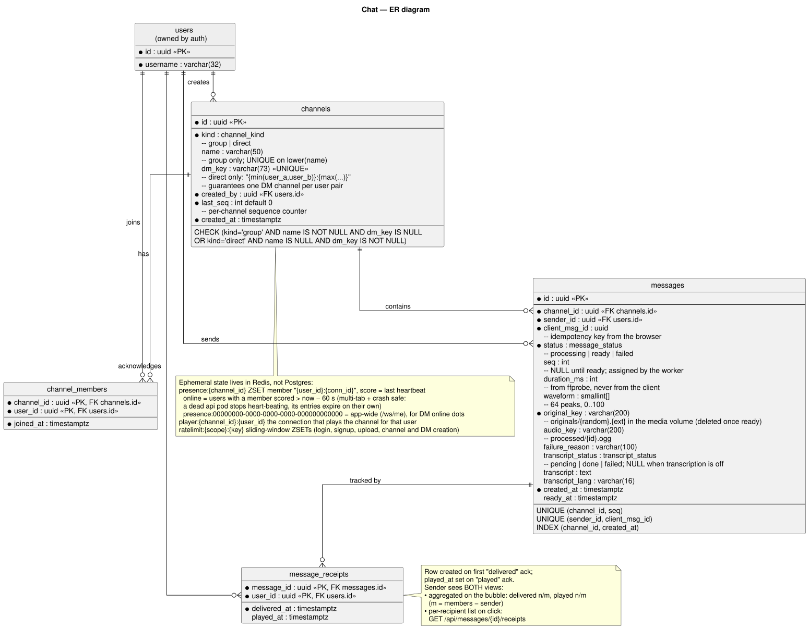

### Voice pipeline: record → upload → process → broadcast (sequence)

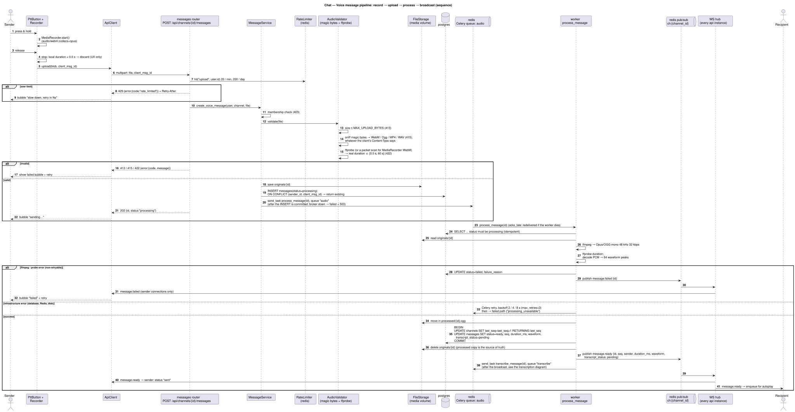

### Reconnect and catch-up (sequence)

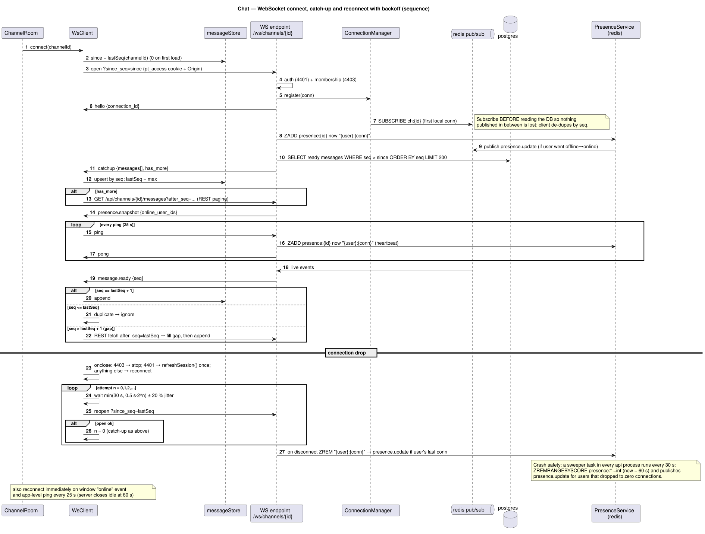

### Playback and receipts (sequence)

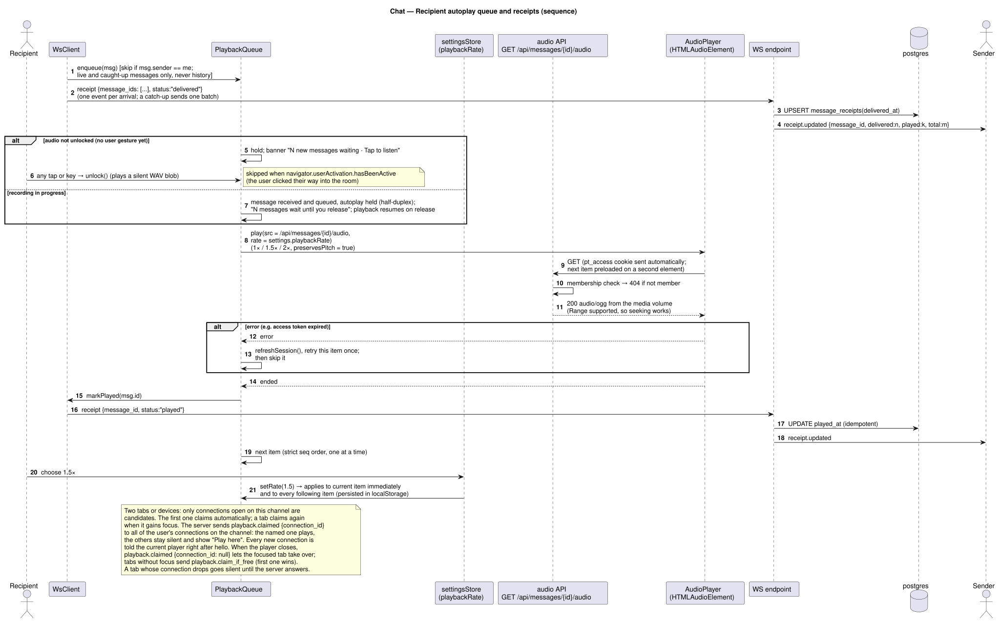

### Transcription (sequence)

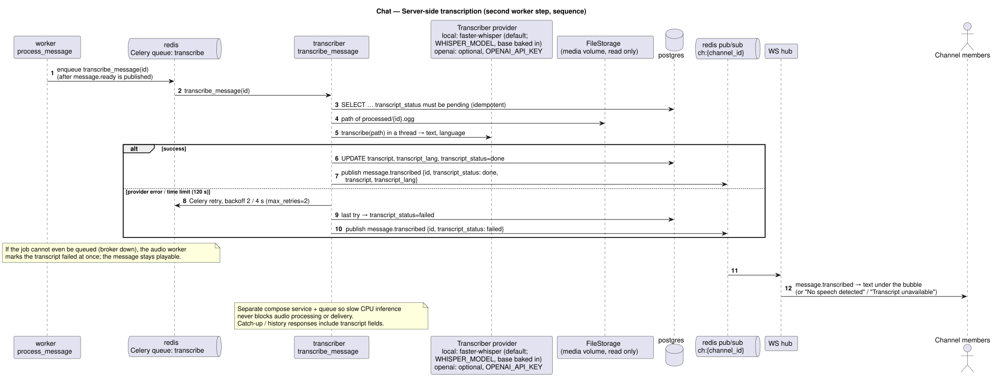

### Direct messages (sequence)

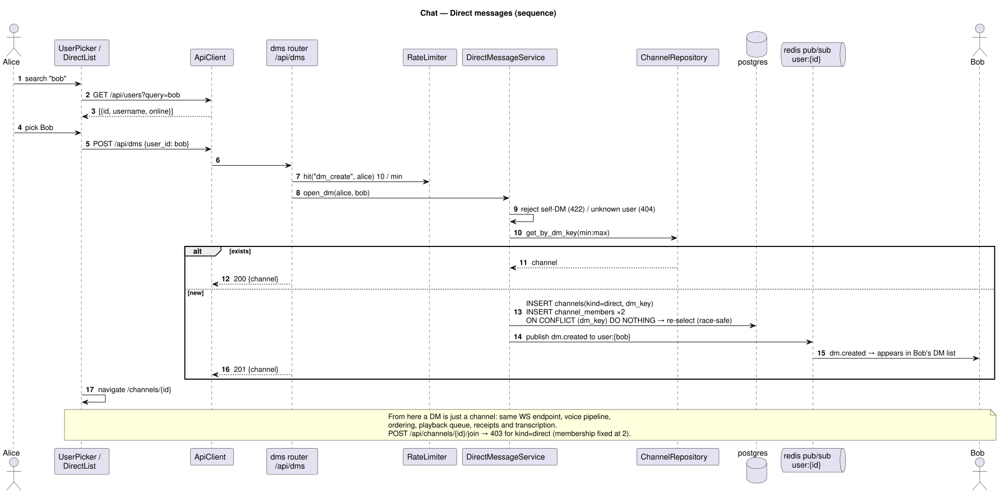

### Message status (state machine)

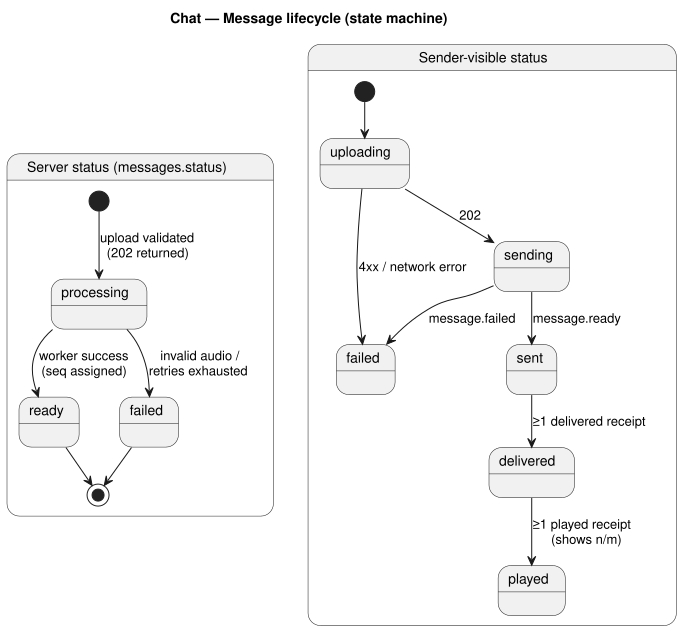

### Playback queue (state machine)

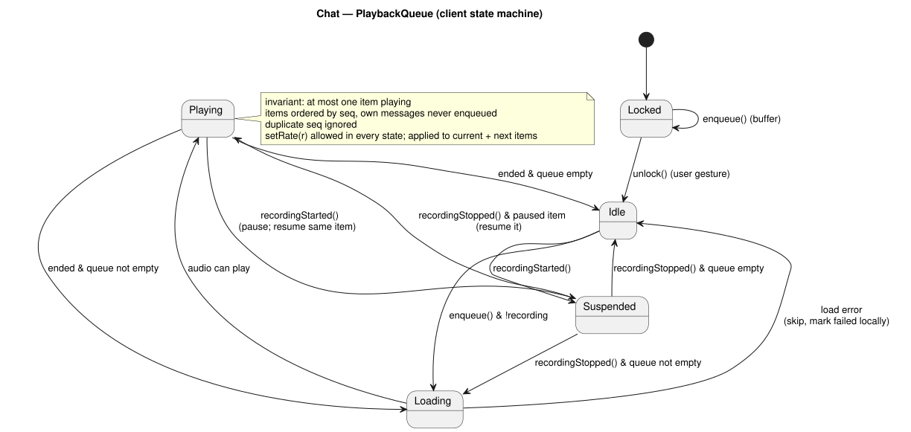

### Backend classes: channels, presence and direct messages

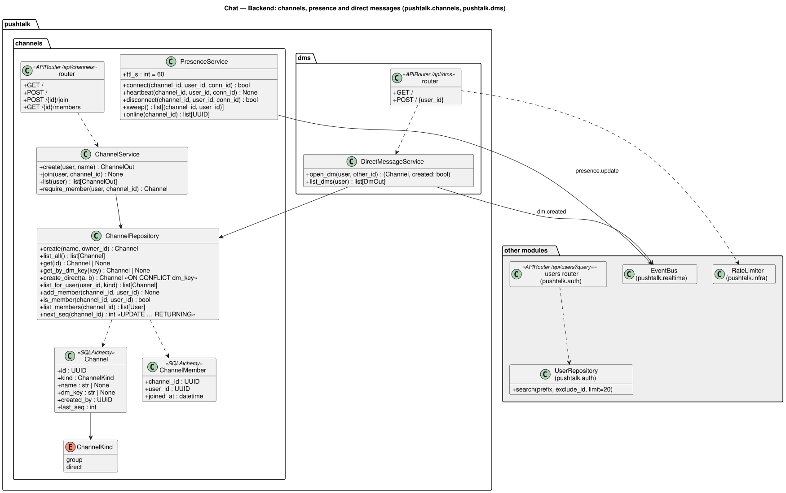

### Backend classes: voice message pipeline

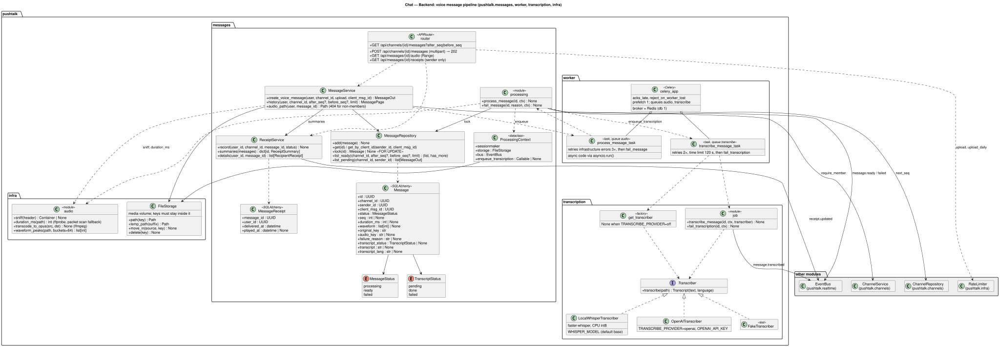

### Backend classes: realtime WebSockets

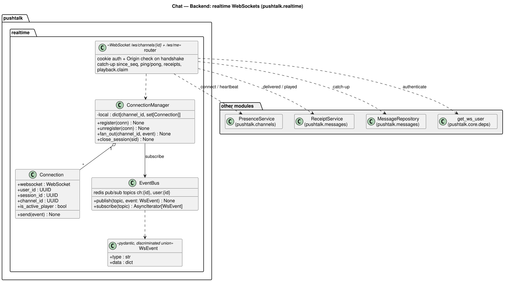

### Frontend classes

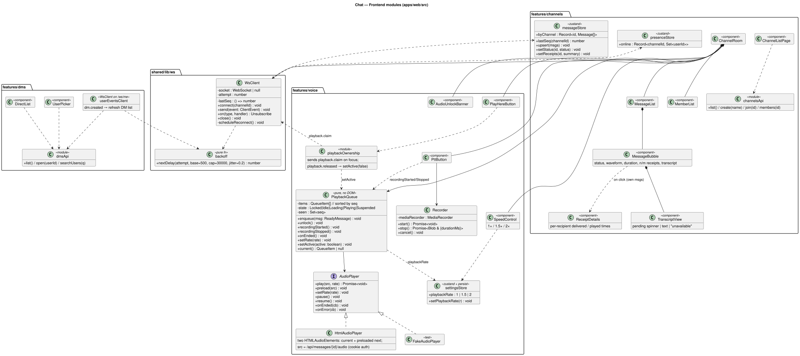

---

## Phase 2: Channels & presence

| # | Task | Acceptance |
| --- | --- | --- |
| 2.1 | Models + migration `0003_channels`: `channels` (incl. `kind`, `dm_key`, CHECK constraint so DMs need no later migration), `channel_members` | — |
| 2.2 | `ChannelRepository`, `ChannelService` (create/join/list/require_member) | non-member → 403 `not_a_member` |
| 2.3 | `routers/channels.py` | REST table above |
| 2.4 | `EventBus` (Redis pub/sub) + `ConnectionManager` (one Redis subscription per channel per API process, local fan-out) | two api replicas both receive events |
| 2.5 | WS endpoint: auth, membership, register, ping/pong, idle timeout | close codes correct |
| 2.6 | `PresenceService`: Redis ZSET `presence:{channel}` holding `"{user}:{conn}"` scored by last heartbeat; heartbeat on each ping; a background sweeper (every 30 s) removes entries older than 60 s and publishes offline updates; snapshot on connect | 2 tabs + close 1 → still online; `docker kill` the api → users go offline within 60 s |
| 2.7 | FE: `ChannelListPage` (list/create/join), `ChannelRoom` shell, `MemberList` with online dots, `WsClient` (connect only) | see others go online/offline live |

## Phase 3: Voice pipeline. Highest-risk, highest-value

| # | Task | Acceptance |
| --- | --- | --- |
| 3.1 | Migration `0004_messages`: `messages` (+ enum, unique `(channel_id, seq)`, `(sender_id, client_msg_id)`); `0005_receipts` adds `message_receipts` in Phase 4 and `0006_transcripts` the transcript columns in Phase 5 | — |
| 3.2 | `FileStorage` on the `media` volume (MinIO images are no longer published; see DECISIONS.md 2.3); tests use a temporary folder | — |
| 3.3 | `AudioValidator`: (a) `Content-Length` and streamed byte cap → 413; (b) **magic-byte sniff** (`1A45DFA3` webm/mkv, `OggS`, `ftyp` mp4, `RIFF…WAVE`) → 415, ignoring the client `Content-Type`; (c) **ffprobe real duration** into the 0.5–60 s range → 422 `invalid_audio` | client-sent duration is never read |
| 3.4 | `MessageService.create_voice_message`: membership → validate → put original → insert `processing` (idempotent on `client_msg_id`) → send `process_message` to queue `audio` after commit (broker down → `failed` + 503) → 202; publish `message.processing` to sender | double POST → same id |
| 3.5 | Celery task `process_message` (queue `audio`): idempotency guard → download → `ffmpeg -ac 1 -ar 48000 -c:a libopus -b:a 32k out.ogg` → ffprobe duration → peaks (decode to s16le 8 kHz, 64 buckets of max abs, scaled 0–100) → upload → tx {next_seq, mark ready} → publish `message.ready` | message plays in another browser |
| 3.6 | Failure handling: `InvalidMedia` → `failed` immediately; transient errors use Celery autoretry (`max_retries=3`, exponential backoff), and the last try → `failed`; `acks_late` redelivers the task if the worker dies. Publish `message.failed`. On success, delete the original (the processed file is the single source of truth). On failure, keep it under `originals/` for debugging | corrupt file → sender sees "failed" |
| 3.7 | Audio endpoint: `require_member` → stream processed object with `Range` support (206), `Cache-Control: private, max-age=3600` | non-member → 404 |
| 3.8 | FE `Recorder` (MediaRecorder, `audio/webm;codecs=opus`, falls back to `audio/mp4` on Safari), `PttButton` (pointer down/up + Space key; `pointercancel`/blur stops; 60 s auto-stop; < 0.5 s discarded locally) | hold → release → upload |
| 3.9 | FE upload with `client_msg_id = crypto.randomUUID()`, optimistic bubble (`uploading → sending → sent / failed`), retry button reusing the same id | — |

## Phase 4: Realtime correctness & playback

| # | Task | Acceptance |
| --- | --- | --- |
| 4.1 | WS catch-up on connect (`since_seq`, subscribe-before-query, LIMIT 200 + `has_more` → REST paging) | — |
| 4.2 | `WsClient` reconnect: `delay = min(30 s, 500 ms·2^n) ± 20 %`, reset on open, immediate retry on `online` event, no retry on 4401/4403 | kill api container → app recovers and catches up |
| 4.3 | `messageStore`: upsert by `seq`, de-dupe, gap detection → REST fill | — |
| 4.4 | **`PlaybackQueue`** (pure TS, injected `AudioPlayer`): states Locked/Idle/Playing/Suspended/Inactive; skip own messages; strict seq order; one at a time; prefetch next | unit-tested |
| 4.5 | `HtmlAudioPlayer`: `<audio src="/api/messages/{id}/audio">` authenticated by the cookie (streaming and seeking work natively); a second element preloads the next item; on error → `refreshSession()` and retry once, then skip | expired access token mid-queue → playback continues |
| 4.6 | `AudioUnlockBanner` + global first-gesture unlock | fresh load + incoming msg → banner, tap → plays |
| 4.7 | Receipts: `delivered` on `message.ready`/catch-up, `played` on `ended`; `ReceiptService` upsert + aggregate → `receipt.updated` to sender | sender sees "played 1/2" |
| 4.8 | Playback ownership: `playback.claim` on open and on focus from tabs open on the channel; `playback.claimed` naming another connection → silent + "Play here" banner | two tabs → audio once; "play here" moves playback |
| 4.9 | `MessageBubble`: waveform bars, duration, status, n/m receipts; history scroll-back (`before_seq`) | — |
| 4.10 | `ReceiptDetails` per-recipient view + `GET /api/messages/{id}/receipts`; `receipt.updated` carries the recipient row so the open panel updates live | sender sees who played it and when |

## Phase 5: "Stretch" features, all required

The brief calls these optional, but they're in scope for this project. Build them **after** Phases 0–4 pass their acceptance checks, because they all reuse the core pipeline.

### 5A. Playback speed 1× / 1.5× / 2×

| # | Task | Acceptance |
| --- | --- | --- |
| 5A.1 | `settingsStore.playbackRate` (persisted); `SpeedControl` segmented button in the room header | survives reload |
| 5A.2 | `PlaybackQueue.setRate(r)` → `AudioPlayer.setRate`, applied to the current item immediately and to every following item; `preservesPitch = true` | switching mid-message changes speed without restarting |
| 5A.3 | Manual replay of a past message (click bubble) uses the same rate | — |

### 5B. Per-user rate limiting

| # | Task | Acceptance |
| --- | --- | --- |
| 5B.1 | Use the shared `RateLimiter` from Phase 1 (Redis sliding window); add the chat rules below as env-configurable `RateLimitRule`s | — |
| 5B.2 | Rules: upload 20/min and 200/day per user; channel create 10/hour; DM create 10/min; login 10/15 min per username **and** 30/15 min per IP; signup 5/hour per IP; WS `receipt`/`playback.claim` 30/s per connection (excess dropped + `error` event) | — |
| 5B.3 | `RateLimited` → 429 envelope + `Retry-After`; FE shows "slow down, retry in N s" on the bubble or form | 21st upload in a minute → 429 |

### 5C. Server-side transcription, a second worker step

| # | Task | Acceptance |
| --- | --- | --- |
| 5C.1 | `Transcriber` protocol; `LocalWhisperTranscriber` using **faster-whisper** (CPU int8, model from `WHISPER_MODEL`, default `base`); `OpenAITranscriber` (used when `TRANSCRIBE_PROVIDER=openai`, needs `OPENAI_API_KEY`); `FakeTranscriber` for tests; `get_transcriber(settings)` factory | — |
| 5C.2 | Separate Dockerfile target `transcriber` (extra deps group `transcribe`) that **downloads the `base` model at build time**, so `docker compose up` needs no runtime download; other sizes download on first use into the `whisper-models` volume; separate compose service on Celery queue `transcribe` | first `up` works with no extra steps |
| 5C.3 | `process_message` enqueues `transcribe_message(id)` **after** publishing `message.ready`, so delivery is never delayed | audio plays before the transcript arrives |
| 5C.4 | Job: idempotent on `transcript_status=pending` → fetch processed audio → transcribe (120 s time limit, `max_retries=2`) → save `transcript`, `lang`, `done` / `failed` → publish `message.transcribed` | — |
| 5C.5 | Catch-up and history include transcript fields; `TranscriptView` in the bubble (spinner / text / "unavailable") | reload shows saved transcripts |
| 5C.6 | Config: `TRANSCRIBE_PROVIDER=local`, `WHISPER_MODEL=base`, `TRANSCRIBE_LANGUAGE=` (auto-detect if empty); `OPENAI_API_KEY`, `OPENAI_TRANSCRIBE_MODEL` only for `openai` | `openai` without a key → clear startup error |

### 5D. Direct messages alongside channels

| # | Task | Acceptance |
| --- | --- | --- |
| 5D.1 | `GET /api/users?query=` (prefix search, excludes self) | — |
| 5D.2 | `DirectMessageService.open_dm`: `dm_key = "{min}:{max}"`, `INSERT … ON CONFLICT (dm_key) DO NOTHING`, then re-select (race-safe), insert both members | two users opening the same DM concurrently → one channel |
| 5D.3 | `GET/POST /api/dms`; `join` returns 403 for `kind=direct`; `GET /api/channels` lists only `kind=group` | — |
| 5D.4 | `/ws/me` user socket + `dm.created` event (published to `user:{id}`) | Bob sees Alice's new DM live |
| 5D.5 | FE: `DirectList` in the sidebar under channels, `NewDirectDialog` (user search); DM room reuses `ChannelRoom` (title = other user's name, presence = their dot) | voice, receipts, transcripts and speed all work in DMs |

## Tests (targeting what's most likely to break)

### Backend (brief requires: upload validation path, worker job)

- Upload validation: rejects oversized file (413); rejects text file renamed `.webm` with `Content-Type: audio/webm` (415, sniffed); rejects 0.3 s and 61 s fixtures (422, real ffprobe on tiny generated fixtures); accepts a 2 s webm → 202 + job enqueued; non-member → 403; duplicate `client_msg_id` → same id, one job.
- Worker: success sets `ready`, `seq = 1` then `2`, duration and 64 peaks, publishes `message.ready`; ffmpeg failure (mocked to raise) → `failed` + `message.failed`; re-running on a `ready` message is a no-op; concurrent ready on the same channel → distinct seqs.
- Catch-up: `list_after(since_seq)` returns ordered, ready-only messages.
- Audio endpoint: member 200, non-member 404, `Range` request → 206.
- Receipts: delivered then played → aggregate `1/1`; `played` twice stays idempotent; details endpoint returns 403 for non-senders.
- Presence: heartbeat expiry → sweeper emits offline; two connections → online until both are gone.
- Rate limiting: 21st upload in a window → 429 with `Retry-After`; window slides; limits are per user (another user is unaffected).
- Transcription: `get_transcriber` returns the local provider by default and refuses `openai` without a key. Job (`FakeTranscriber`): success → `done` + event; exception → retry → `failed`; re-run on `done` is a no-op; `process_message` enqueues it only on success.
- DMs: open twice → same channel; concurrent open → one row; self-DM 422; non-participant can't join (403) or fetch audio (404).

### Frontend (brief requires: playback-queue logic in isolation)

Using `PlaybackQueue` + `FakeAudioPlayer`:

- plays in seq order even if enqueued out of order
- never plays two at once (enqueue during Playing → waits)
- skips own messages; ignores duplicate seq
- Locked buffers until `unlock()`, then drains in order
- `recordingStarted()` pauses current; `recordingStopped()` resumes it, then continues
- load error → skip to next, doesn't stall
- `markPlayed` called exactly once per item
- `backoff.nextDelay` caps at 30 s and stays within the jitter bounds
- `setRate(1.5)` while Playing changes the current item's rate; later items start at 1.5
- `messageStore` gap detection triggers a fetch for exactly the missing range

## Known issues to document (the brief requires "note any known issues in other browsers")

These are platform facts, not cut features. Each is handled in code and noted in the README:

- **Safari** records `audio/mp4` (AAC). The sniffer accepts `ftyp` and ffmpeg normalises it to Opus/OGG, so uploads from Safari work. Playback of OGG/Opus depends on the Safari version. Verify it on the installed version and record the result in the README (the brief only requires Chrome).
- **Firefox** records `audio/ogg;codecs=opus`, which works with no special handling.
- **Mobile browsers** throttle background tabs: autoplay resumes and the queue drains when the tab is foregrounded.
- **Ordering** follows processing completion (decision 5). This is a deliberate trade-off, not a missing feature.
